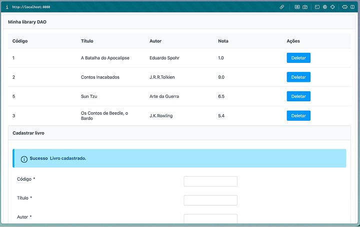
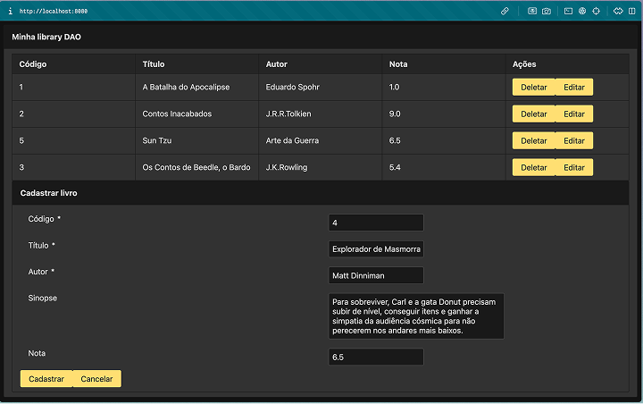
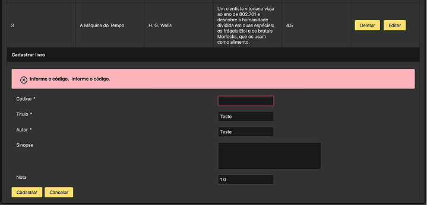
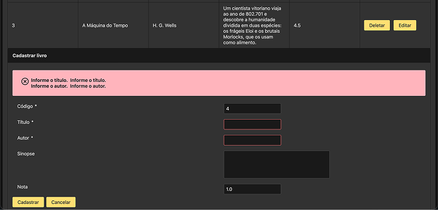
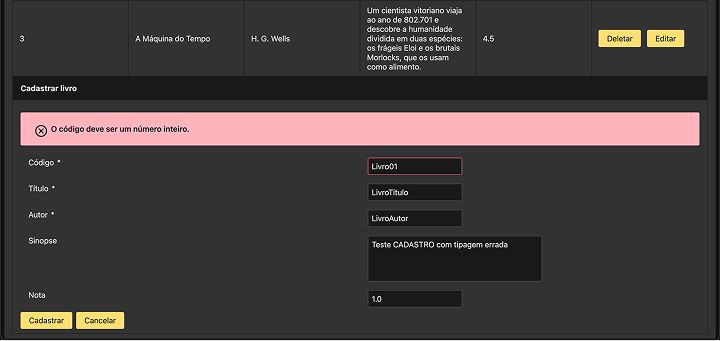
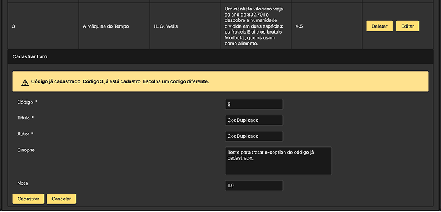
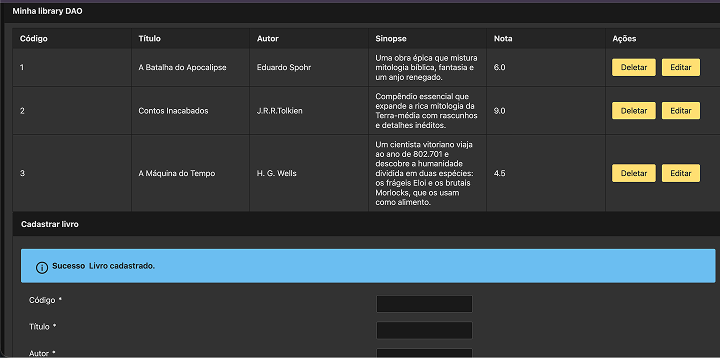
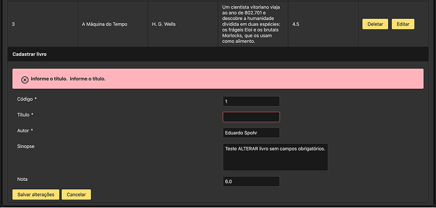
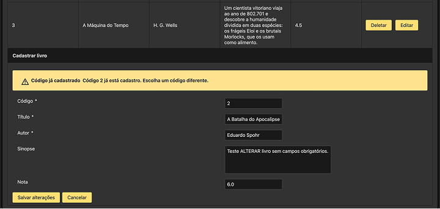

# 📚☕️ Tarefa Módulo 39 - Projeto Tomcat

Projeto DAO monolítico, implementado em padrão JPA, com persistência PostgreSQL, interatividade JSF e ambiente `Tomcat`.
A implementação é um sistema de cadastro de livros, com interface em template `Primefaces`.
 
Este projeto serviu para reforçar a base dos meus estudos em `Docker`, sendo de construção de imagem com `Dockerfille`,
mapeamento de portas e construção de ambiente Servlet e database com `Docker-compose`.

> O estudo está documentado ao final do README.

## 📖 Minha Library DAO

O projeto possui o mesmo padrão de camadas DAO implementado em `JPA/Hibernate` já apresentado em outros módulos do
curso. Então, decidi destacar as partes que mais sofreram mudanças no projeto, graças a inclusão do `JavaServer Faces`.  

<details><summary>LivroController</summary>

````java
@Named("livroController") //Disponibiliza o bean no xhtml como #{livroController}
@ViewScoped
public class LivroController implements Serializable {

    private static final long serialVersionUID = 1L;
    private static final Logger LOG = Logger.getLogger(LivroController.class.getName());

    @Inject
    private IService<Livro, Long> livroService;

    private List<Livro> livros;

    @PostConstruct
    public void init() {
        carregarLivros();
    }
    
    ///restante dos metodos de controle
}
````

| Anotação       | Função                                                                                          |
|----------------|-------------------------------------------------------------------------------------------------|
| @Named         | Transforma a classe Java em um `CDI Bean`, dando a ela um nome acessível para a camada `.xhtml` |
| @ViewScoped    | Garante que os dados do Controller permaneçam vivos enquanto o usuário estiver interagindo      |
| @Inject        | Delega a responsabilidade de instanciação de `Entidade` ao servidor                             |
| @PostConstruct | Ideal para carregar dados, buscar parâmetros e preparar o estado inicial da tela  corretamente  |

</details>

<details><summary>index.xhtml</summary>

````xhtml
<!DOCTYPE html>
<html xmlns="http://www.w3.org/1999/xhtml"
      xmlns:h="jakarta.faces.html"
      xmlns:p="primefaces"
      lang="pt-BR">

<h:head>
    <title>Biblioteca</title>
</h:head>

<h:body>
    <p:panel header="Minha library DAO">

        <h:form id="formLista">
            <p:dataTable id="tabelaLivros"
                         value="#{livroController.livros}"
                         var="livro"
                         emptyMessage="Nenhum livro cadastrado.">

                <p:column headerText="Código">
                    <h:outputText value="#{livro.codigo}" />
                </p:column>

                <p:column headerText="Título">
                    <h:outputText value="#{livro.titulo}" />
                </p:column>

                <p:column headerText="Autor">
                    <h:outputText value="#{livro.autor}" />
                </p:column>

                <p:column headerText="Sinopse">
                    <h:outputText value="#{livro.sinopse}" />
                </p:column>

                <p:column headerText="Nota">
                    <h:outputText value="#{livro.nota}" />
                </p:column>

                <p:column headerText="Ações">
                    <p:commandButton value="Deletar"
                                     action="#{livroController.deletar(livro)}"
                                     process="@this"
                                     update="@form :formCadastro"
                                     resetValues="true" />

                    <!-- GAP -->
                    <p:spacer width="8" height="1" />

                    <p:commandButton value="Editar"
                                     action="#{livroController.editar(livro)}"
                                     process="@this"
                                     update=":formCadastro"
                                     resetValues="true" />
                </p:column>

            </p:dataTable>
        </h:form>

        <h:form id="formCadastro">

            <p:panel header="Cadastrar livro">

                <p:messages id="mensagens" showDetail="true" />

                <p:panelGrid columns="2">

                    <p:outputLabel for="codigo" value="Código" />
                    <p:inputText id="codigo"
                                 value="#{livroController.novoLivro.codigo}"
                                 required="true"
                                 requiredMessage="Informe o código."
                                 converterMessage="O código deve ser um número inteiro." />

                    <p:outputLabel for="titulo" value="Título" />
                    <p:inputText id="titulo"
                                 value="#{livroController.novoLivro.titulo}"
                                 maxlength="255"
                                 required="true"
                                 requiredMessage="Informe o título." />

                    <p:outputLabel for="autor" value="Autor" />
                    <p:inputText id="autor"
                                 value="#{livroController.novoLivro.autor}"
                                 maxlength="255"
                                 required="true"
                                 requiredMessage="Informe o autor." />

                    <p:outputLabel for="sinopse" value="Sinopse" />
                    <p:inputTextarea id="sinopse"
                                     value="#{livroController.novoLivro.sinopse}"
                                     rows="4"
                                     cols="40"
                                     maxlength="255" />

                    <p:outputLabel for="nota" value="Nota" />
                    <p:inputNumber id="nota"
                                   value="#{livroController.novoLivro.nota}"
                                   decimalPlaces="1" />

                </p:panelGrid>

                <p:commandButton
                        value="#{empty livroController.novoLivro.id
                               ? 'Cadastrar' : 'Salvar alterações'}"
                        action="#{livroController.salvar}"
                        process="@form"
                        update="@form :formLista:tabelaLivros" />
                <p:spacer width="8" height="1" />
                <p:commandButton value="Cancelar"
                                 action="#{livroController.cancelar}"
                                 process="@this"
                                 update="@form"
                                 resetValues="true" />
            </p:panel>

        </h:form>

    </p:panel>
</h:body>

</html>
````

</details>

## 🖼️ Interface

A tarefa deste módulo pediu prints que mostrasse a interface da aplicação, as mecânicas e os tratamentos de exceptions.
Os prints estão separados por categoria, com suas principais exceptions.

<details><summary>Prints - Cadastro</summary>
<div>
    <p>Primeiro teste de interface</p>
    
</div>
<div>
    <p>Interface com template primefaces 'luna-amber' aplicada</p>
    
</div>
<div>
    <p>Exception campo obrigatório - Código</p>
    
</div>
<div>
    <p>Exception campo obrigatório - Título e Autor</p>
    
</div>
<div>
    <p>Exception ERROR - Código como String (tipagem incorreta)</p>
    
</div>
<div>
    <p>Exception WARNING - Código já cadastrado</p>
    
</div>
<div>
    <p>Cadastro efetuado</p>
    
</div>
</details>

<details><summary>Prints - Edição</summary>
<div>
    <p>Exception campo obrigatório para Alteração - Código</p>
    
</div>
<div>
    <p>Exception WARNING - Tentativa de alteração com código já cadastrado</p>
    
</div>
</details>

## Contruindo Tomcat com [docker-compose](docker-compose.yaml)

```yaml
services:
  tomcat:
    build: .
    ports:
      - "8080:8080"
```
| Trecho | Função                                       |
|--------|----------------------------------------------|
|services| Lista os serviços que o Compose vai executar |
|tomcat| Nome que você deu ao serviço                 |
|build: .|Constrói a imagem usando o Dockerfile desta pasta|
|"8080:8080"|Conecta a porta 8080 do seu computador à porta 8080 do container|

> Na forma curta, `build` aponta para uma pasta, chamada **contexto de construção**, onde o Docker procura
> um arquivo chamado `Dockerfile`. O `.` indica a pasta do Compose, que neste projeto também é a raiz do projeto.

Caso o Dockerfille estiver em um sub diretório, a escrita se torna mais explicita;

```shell
projeto/
├── docker-compose.yaml
└── docker/
    ├── tomcat9/
    │   └── Dockerfile
    └── tomcat11/
        └── Dockerfile
```
No compose:

```yaml
services:
  tomcat:
    build:
      context: .
      dockerfile: docker/tomcat11/Dockerfile
    ports:
      - "8080:8080"
```
## 📚 Anotações de estudo: Compose, portas e conexão com PostgreSQL

### O que pertence ao Dockerfile e ao Compose?

| Arquivo | Responsabilidade | Exemplo neste projeto |
|---|---|---|
| `Dockerfile` | Define como construir uma imagem | Partir de `tomcat:11.0-jdk17` e, depois, incluir o WAR da aplicação com `COPY` |
| `docker-compose.yaml` | Define como executar e conectar os serviços | Tomcat, PostgreSQL, portas, variáveis, volumes e dependências |
| `pom.xml` | Declara as bibliotecas e a construção do projeto Java | Hibernate e driver JDBC do PostgreSQL |


### Mapeamento de portas

No serviço PostgreSQL:

```yaml
ports:
  - "127.0.0.1:${POSTGRES_PORT:-5433}:5432"
```

Aqui o sinal `:-` é um **operador de valor padrão**. Ou seja: use `POSTGRES_PORT`, mas caso a variável não esteja
definida ou for vazia, use `5433`.

Sem a variável `${POSTGRES_PORT:-5433}` no `.env`, a sintaxe de ***ports*** seria:

```yaml
ports:
  - "127.0.0.1:5433:5432"
```

| Parte | Significado                                                         |
|---|---------------------------------------------------------------------|
| `127.0.0.1` | Publica a porta apenas no endereço local do computador              |
|`${POSTGRES_PORT:-5433}`| Indicador de variável de porta Postgre com valor padrão alternativo |
| `5433` | Porta pela qual o computador acessa o banco                         |
| `5432` | Porta em que o PostgreSQL escuta dentro do container                |

> A porta publicada **pode ser diferente da porta interna**.
Por exemplo: `9000:8080` publicaria o Tomcat em `localhost:9000`, mantendo o servidor na porta interna `8080`.
Mudar o mapeamento não muda a porta em que o programa escuta dentro do container.


### DB_URL com valores para IntelliJ e para Tomcat

O endereço de `DB_URL` pode ter valores diferentes em cada processo:

| Ambiente                                           | Quem fornece a `DB_URL` | Valor de exemplo |
|----------------------------------------------------|---|---|
| 🖥️ Teste JUnit no IntelliJ (interno)               | `.env`, lido pelo `Dotenv` | `jdbc:postgresql://localhost:5433/postgresbookdb` |
| 📡 Aplicação dentro do container Tomcat (servidor) | `environment` do serviço no Compose | `jdbc:postgresql://postgres:5432/postgresbookdb` |

O nome `postgres` é o nome do serviço, **definido na rede do Compose**. O teste local usa a porta publicada em `localhost`
e o Tomcat, `localhost` usa a porta `PostgreSQL`.

No projeto, o Compose define explicitamente o endereço interno para o Tomcat:

```yaml
environment:
  DB_URL: jdbc:postgresql://postgres:5432/${POSTGRES_DB:?Defina POSTGRES_DB}
```
### Variaveis de Ambiente

Assim como a Classe [ConfigManager](src/main/java/com/fabioperettig/config/ConfigManager.java), as variaveis
de ambiente também precisam ser mencionadas, através da sessão `enviroment`, tanto para o serviço Tomcat, quando
para o Postgres.

```yaml
services:
  tomcat:
    build: .
    ports:
      - "8080:8080"

    #VAR DE AMBIENTE TOMCAT 
    environment:
      DB_URL: jdbc:postgresql://postgres:5432/${POSTGRES_DB:?Defina POSTGRES_DB}
      POSTGRES_USER: ${POSTGRES_USER:?Defina POSTGRES_USER}
      POSTGRES_PASSWORD: ${POSTGRES_PASSWORD:?Defina POSTGRES_PASSWORD}

    depends_on:
      postgres:
        condition: service_healthy

  postgres:
    image: postgres:15
    
    #VAR DE AMBIENTE POSTGRES
    environment:
      POSTGRES_DB: ${POSTGRES_DB:?Defina POSTGRES_DB no .env}
      POSTGRES_USER: ${POSTGRES_USER:?Defina POSTGRES_USER no .env}
      POSTGRES_PASSWORD: ${POSTGRES_PASSWORD:?Defina POSTGRES_PASSWORD no .env}

    ports:
      - "127.0.0.1:${POSTGRES_PORT:-5433}:5432"

    volumes:
      - postgres_data:/var/lib/postgresql/data

    healthcheck:
      test: [ "CMD-SHELL", "pg_isready -U \"$${POSTGRES_USER}\" -d \"$${POSTGRES_DB}\"" ]
      interval: 5s
      timeout: 5s
      retries: 10
      start_period: 10s

volumes:
  postgres_data:
```

------

**Fabio Peretti Guimarães | tarefa Ebac mod 39 | OUT 2026**
